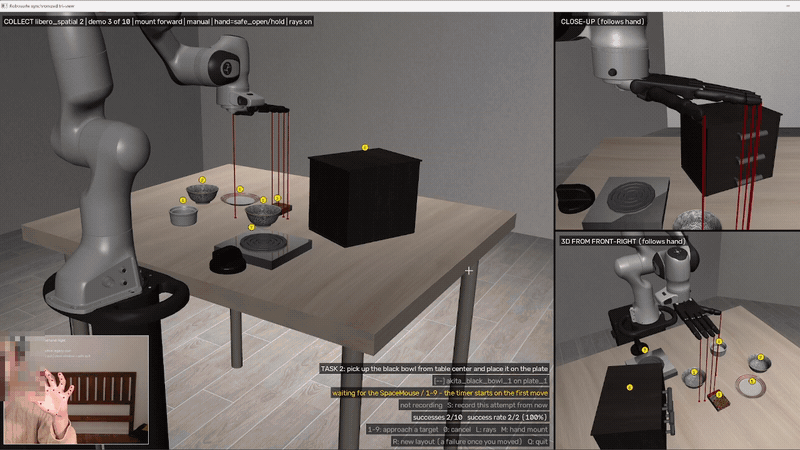
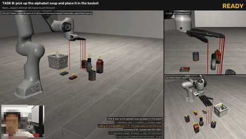
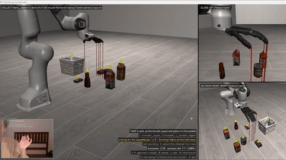
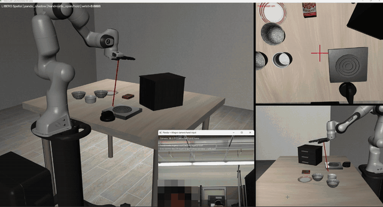
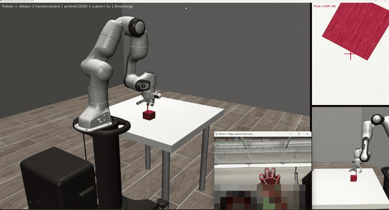
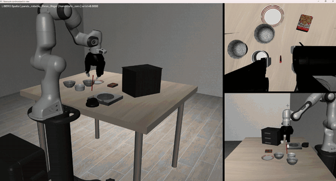
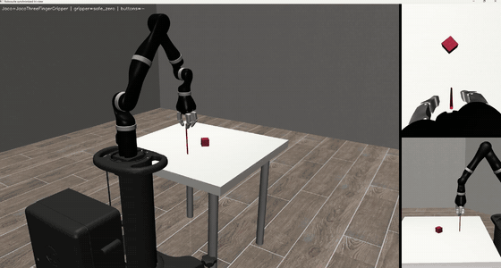
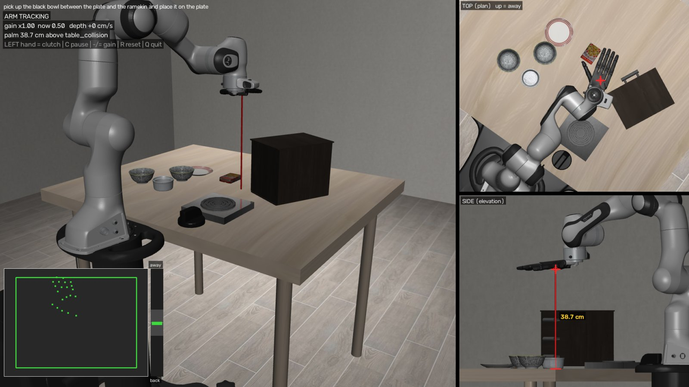

# Vision-Based Hand-Arm Retargeting

**Driving a simulated robot arm and a dexterous robot hand with a SpaceMouse and a laptop webcam.**

  
   
  One of my data-collection attempts (2026-11-11), LIBERO's "pick up the black bowl from table center and place it on the plate". Key 1 has a small planner bring the hand over the bowl, a short SpaceMouse nudge and my right hand in the little webcam window do the grasp, key 5 carries the bowl over the plate, I open my hand, and LIBERO's own success check fires at 7.7 s. 2x speed; click for three attempts in a row at real speed. The pixel blob in the webcam window is my face.

Hi, I'm Eason, a master's student at UVA, and this is my teleoperation playground in Prof. Yen-Ling Kuo's LIVE Robotics Lab. The question behind it is pretty simple: how far can you get controlling a robot hand with stuff that's already on your desk? No data glove, no mocap suit, no VR headset. Just a 3Dconnexion SpaceMouse and a webcam.

The setup, in one breath:

- the **SpaceMouse** moves the arm (a Franka Panda, sometimes a Kinova Jaco);
- the **webcam** watches my right hand with MediaPipe, and my finger pose gets copied ("retargeted") onto a robot hand: Allegro (4 fingers), Shadow (5 fingers), or a simpler gripper;
- lately I've been trying to drop the SpaceMouse and do **everything from the webcam**, so where my hand is also moves the arm. That part is still in progress.

It all runs in simulation (robosuite + MuJoCo, plus scenes from the LIBERO benchmark) on a Windows laptop.

### The one rule: no shared control

The robot never helps. No auto-grasp, no snapping to objects, no "smart" correction of my motion: the human's weight is 1. Safety code may slow a command down or refuse it, but it never moves the robot on its own. I even removed two convenience features (a precision mode and a "only rotate around the vertical axis" mode) because they quietly changed how my hand maps onto the robot. If a grasp fails, that's on me and on the interface, and the interface is the thing I actually want to study.

One experiment is deliberately different and lives in its own scripts: an approach planner I call with a number key (more below), which my data-collection script uses too. It only moves when I ask, it never mixes with my input, and the moment I touch the SpaceMouse it stops and the arm is mine again. The lab doesn't count that kind of hand-over as shared control, and the regular entries stay pure teleop.

## Demos

All recorded by me, trimmed, with the faces in the webcam window pixelated. The GIFs are sped up; click one for the MP4.

### November: collecting LIBERO demos

  
  

- **Alphabet soup into the basket** (libero_object, 2026-11-10). This one is the collection script's own recording, so it has the timer on top and the green SUCCESS at 14.1 s. GIF at 2x; the MP4 is 1920x1088 at real speed.
- **Tomato sauce, the last three of ten** (libero_object, 2026-11-11): 8.7, 8.6 and 8.4 s, then "all tasks done". GIF at 4x; the MP4 is a 720p screen capture at real speed.

All of these attempts go the same way. A number key sends the planner to the object, I bring the hand down the last bit with the SpaceMouse and close my real hand, a second key carries the object over the basket or plate, and I open my hand. In the quick ones the planner does most of the travel (4-6 s of an 8 s attempt) and the SpaceMouse about a second; the fingers are always mine. The red lines are rays going straight down from each fingertip (`L` turns them off).

### October: first versions

  
  
  
  

Recorded on 2026-10-22. GIFs at 4x (Allegro 3x), MP4s at half that. From left to right:

- **Panda + Shadow Hand** in a LIBERO kitchen scene, SpaceMouse and webcam only, no planner yet.
- **Panda + Allegro Hand.** Grab the cube, lift it. Arm from the SpaceMouse, fingers from the webcam. Getting the thumb to actually pinch took the longest.
- **Panda + Robotiq 3-finger gripper** in the same LIBERO scene as the Shadow clip. Hold one SpaceMouse button to close, the other to open.
- **Jaco + 3-finger gripper** lifting a cube, after I sped up its gripper.

To be upfront: LIBERO's official success check didn't fire in any of the October runs. The task wants the bowl on the plate; in the Shadow clip I put it on the stove. The November clips are official successes.

## How it works, roughly

### Arm: SpaceMouse

The SpaceMouse gives six numbers per tick: push/pull along three axes and twist around three. I map them relative to the camera you're looking through, so pushing forward always means "into the screen", whatever the robot's base frame thinks. After deadzones and a bit of filtering, each tick becomes a small pose step for robosuite's operational-space controller (`OSC_POSE`). Let go and the target pose freezes, so the arm doesn't keep creeping.

### Fingers: webcam

MediaPipe gives 21 keypoints on my hand every frame. There are two ways to turn those into robot finger angles:

1. **A hand-written mapping (`curl-pinch`).** Measure how bent each of my fingers is, plus how close my thumb tip is to each fingertip, and drive the robot fingers from that. Simple, predictable, and surprisingly good at pinches.
2. **[dex-retargeting](https://github.com/dexsuite/dex-retargeting)** (vector and DexPilot optimizers), which solves for the robot joint angles whose fingertip geometry looks most like mine. It lives in its own Python environment, so the teleop loop talks to it through a side process.

### Webcam-only mode (work in progress)

Here one webcam controls both the arm and the fingers. From a single RGB image the code estimates where my wrist is in 3-D, in meters, using the shape of my palm as a ruler. Then:

- moving my hand in any direction (left/right, up/down, toward/away from the camera) moves the robot like a mouse pointer: slow hand, fine motion; fast hand, bigger jumps. Still hand, still robot;
- turning my palm turns the robot hand, but only while my hand isn't sliding around, so moving doesn't accidentally twist it;
- showing my left hand is a clutch, like lifting a mouse off the mousepad: the robot holds still while I reset my right hand;
- after a pause or when the camera loses my hand, the robot waits until my hand is held still again, then carries on from where it is.

The operator screen for the webcam-only mode: the main view, a top view and a side view (orthographic, so distances don't lie), and the webcam preview with a safe zone and a depth gauge. This shot is from a scripted test hand, not a real run.

### Approach planner (experiment, its own script)

My professor suggested trying a motion planner for the approach, so this script hands just that one step to a planner. Every object gets a small number on screen. I press the number, and the planner moves the arm until the hand sits over the object, lowest fingertip 2 cm above its top, wrist orientation unchanged. With the palm facing down it lines up the roots of the robot hand's index, middle and ring fingers with the object, so the object ends up under the base of the fingers. Until 2026-11-10 it aimed with the point between the thumb tip and the index/middle tips, which left the object under the fingertips, and I had to nudge the hand about 5 cm forward after every approach. With the fingers pointing down it still uses that thumb/fingertip point. Then I take over with the SpaceMouse for the fine approach and the grasp. The webcam drives the fingers the whole time.

How it picks a path: it first tries plain straight routes (lift, slide over, come down; or one diagonal line to just above the object, then down). It walks the whole arm along each route in 1 cm steps with the hand's orientation held fixed, and checks that no part of the robot gets within 1.5 cm of anything in the scene (0.5 cm in the last stretch right above the object). The first route that passes is the plan, usually found in 20-50 ms. Only when every straight route is blocked or out of reach does it hand the problem to OMPL's RRT-Connect, which searches over the seven arm joints but keeps the hand within about 30 degrees of its orientation.

Knobs: `--sim-speed 0.6` runs the simulation in slow motion (30 ms of sim time per 50 ms real tick), `--planner-speed` sets how fast the planner moves the hand (0.3 m/s by default), and `M` swaps the hand between fingers-down and palm-parallel-to-the-table while the program runs (the task starts over).

### Collecting LIBERO demos (its own script)

Next step is data, so this script is the planner entry (number keys, fingertip rays, `M` for the mount) with the bookkeeping around it. The planner still only moves the arm after I press a number and drops out the moment I touch the SpaceMouse. The task's own success conditions from its BDDL file sit in the corner of the main view, one line each, green once they hold. When LIBERO's official check has held for half a second it counts as a success, the objects get a new random layout, and after 10 successes it moves on to the next task. The layouts come from LIBERO's own placement regions, not the 50 official start states, which I'm keeping for evaluation. Every attempt I start gets logged, so the success rate falls out for free. `R` gives up on a layout (counts as a failure once the arm has moved), `M` swaps the hand mount and keeps the layout.

What it writes is deliberately small: one CSV with a row per attempt (result, time, layout, mount, what ended it) and screen recordings of the attempts I want to keep. Pressing `S` starts recording the current attempt from that moment until it ends (press it before I start moving and I get the whole attempt), pressing it again cancels, and without `S` nothing gets recorded at all. The recording is just the window I'm looking at, webcam inset included, with a big timer on top and SUCCESS / FAILED / QUIT at the end, and it only shows up in the videos folder once it's finished. Raw simulator demos for training are opt-in (`--save-demos`); a separate script turns those into a LIBERO-format dataset. It can also copy the CSV and the videos into a folder that OneDrive syncs, so I can post one link in the lab Slack. The close-up is the planner entry's close-up after two presses of `V` (camera on the robot's left, looking at the hand), locked there and flipped left-right because that's easier for me to steer by. Nothing else about it changed.

## Stuff I learned the hard way

**The drift wasn't the SpaceMouse.** For a while the arm slid around, up to 11 cm, just from me moving the fingers. My first suspect was the SpaceMouse. The real cause: every step the controller re-anchored its goal to wherever the wrist actually was, and the point it tracked wasn't rigid, so small errors kept piling up. Holding a fixed desired pose and moving the control point onto a rigid tool frame took the drift from **109 mm to 0.26 mm**.

**The sim was slow for boring reasons.** The LIBERO loop ran at 8 Hz, which makes teleop feel like steering a boat. The culprits: rendering a camera image nobody used, Python's `sleep` on Windows oversleeping by about 14 ms per call, and resizing a big frame for display. With those fixed it runs at about 21 Hz.

**The Panda's elbow singularity isn't where I thought.** I assumed the arm goes singular when the elbow (joint 4) hits its straight limit at −0.07 rad. Because of small offsets between the Panda's links, it actually loses a direction of motion around **−0.47 rad**. Once the safety margin sat in the right place (keep joint 4 below −0.82 rad, which costs about 1 cm of reach), I could delete my "auto-escape" code. Good riddance: a robot backing itself out of trouble is exactly the kind of help I don't want.

**A joystick for depth was a bad idea.** My first version treated depth like a joystick: hold your hand closer to the camera than where you started and the robot keeps moving away. In the first real-hand test the arm kept speeding toward the far side of the table while my hand was basically still. My hand had drifted about 4 cm closer without me noticing, and a slow depth filter kept the estimated offset growing for a while after I stopped. The logs also showed that every time tracking restarted, it grabbed the "neutral" depth while my hand was still moving back into place, so the arm drove off on its own. Now depth works like the other directions, and tracking only restarts from a hand that has settled.

**Thumbs are the hard part.** Four fingers mostly just curl. The thumb has to swing across the palm to meet them. Just bending the Allegro's thumb joints left its tip about 3 cm from the index fingertip in a "pinch". Blending in a proper opposition pose (and later a continuous "how far across the palm is my thumb" value) gets it to about 1.7 cm, basically touching.

**My first planner flipped the hand around.** In the first real session with it, about half of the plans failed, and a few of the successful ones swung the whole hand around while I was carrying something. The logs had three separate reasons. After I'd twisted the wrist, a joint sat right on its limit, and the planner threw out that start pose before searching at all. The goal kept my wrist orientation, which the fingers-down hand often just can't reach. And when the inverse kinematics found no solution near the current arm posture, it tried random restarts, and some landed on a completely different arm configuration, so the path in between rotated everything (6-8 rad of total joint motion). It also kept no safety distance, which is how the hand clipped the milk carton on its way to the butter. Trying the boring straight routes first, holding the orientation fixed and following the arm step by step so it can't jump to another configuration, plus real clearance, fixed all of that in simulation.

**How the hand is mounted matters a lot.** I sampled 90 palm-down poses over the table. From the start posture the arm reaches 71-84 of them with the hand mounted palm-parallel, but only 16-68 with the fingers-down mount, which first has to turn the wrist by about 100-120 degrees and then sits within 0.1 rad of a joint limit. That matches the jumpy wrist I noticed. The palm-parallel mount has its own catch: the hand sticks out about 12 cm in front of the wrist, so for objects close to the robot base the elbow runs out of fold and only the OMPL fallback gets there.

**Random layouts drop things.** My first test of the collection script flagged two bottles as knocked over that nothing had touched. LIBERO places objects a few centimeters above the table and lets them fall, and they can shift 5-10 cm in the first second. Each attempt now waits until everything has landed before it starts.

**The SpaceMouse went deaf after every new layout.** While collecting, I'd press 1, the planner would park the hand over the ketchup, and then the SpaceMouse did nothing for three or four seconds. On every new layout the input code clears its state, so an old push can't leak into the new scene, but it also threw away the zero point it had learned at startup. Learning it again takes eight quiet reports in a row, and my SpaceMouse Wireless sends nothing at all while nobody touches it, while a real push stops being quiet after a report or two. So it only caught up when my hand happened to rest on it lightly. The zero point belongs to the device, not the scene, so now it survives a new layout. In the logs, the time from the planner parking the hand to the SpaceMouse actually moving it went from a median of 3.2 s (15 approaches before the fix) to 0.34 s (40 after).

**Opening the CSV killed the program.** Twice in a row the collection script quit right after the first success, without a word. The attempts table was open in WPS, which locks the file, so the new row had to wait in memory. That part is by design. But the warning about it went to stderr, and stderr was broken: MediaPipe imports sounddevice, sounddevice briefly points the process's stderr at NUL and back while it starts PortAudio, and Python 3.8's console stderr keeps the old, now closed handle. The warning raised, the error handler's own message raised again, and the program died silently. Tests never caught it because there stderr isn't a console. The collection script now reopens stderr at startup, and the later real runs didn't hit it again.

## What doesn't work yet

- The SpaceMouse works, but being precise with it still takes practice, especially when you need translation and rotation at the same time.
- The hands are fine at two-finger pinches and simple grasps. More complex finger motions are basically untested, and the thumb logic still needs work.
- Shadow Hand with DexPilot: the thumb / flat-hand / pinch changes from 2026-11-04 are in every real session since 11-07, but I've only checked them by eye (the OK sign closes), not measured how closely the robot fingers follow mine.
- The webcam-only mode has had exactly one real-hand session (2026-10-27). It showed the depth problem above and a lag of about 0.3 s between my hand in the camera preview and the robot. The fixes cut the lag in simulation (less filtering, a stiffer arm, a higher speed cap), but I haven't re-tested them with my real hand yet.
- The approach planner now does most of the travel in my collection sessions. On 11-11 I pressed a number key 120 times: it found a path 116 times (84 straight routes, 32 from OMPL) and arrived 83 times, 26 times I took over early with the SpaceMouse, and 3 times it found no path or the start was already blocked. It still only knows the hand shape from the moment I press the key, and my real fingers can change shape mid-move.
- The data-collection script has had real sessions on 11-09, 11-10 and 11-11. Its tables now hold 56 attempts and 47 successes (median 13.5 s per success), and four tasks have their ten: ketchup, tomato sauce and butter in libero_object, and the bowl from the table center in libero_spatial. 44 of those successes came in about half an hour on 11-11. None of these sessions saved raw trajectories (`--save-demos` is opt-in), so for now it's success rates and timings, not a training set.
- No user study. Everything here is "I tried it and it felt OK".

Next up: the remaining libero_object and libero_spatial tasks, real-hand runs of the webcam-only mode, then a small comparison of the input setups with people who aren't me.

## Running it

Windows only for now. Two virtual environments, because LIBERO wants an older robosuite:

- `.venv-robosuite`: Python 3.10, robosuite 1.5.2, MuJoCo 3.3.7 (`requirements-robosuite-wrist.lock`)
- `.venv-libero`: Python 3.8, robosuite 1.4.0, MuJoCo 3.2.3, plus LIBERO installed from a clone of [LIBERO](https://github.com/Lifelong-Robot-Learning/LIBERO) at commit `8f1084e` in `third_party/LIBERO` (not included in this repo; see `docs/libero_windows.md`)
- dex-retargeting 0.4.6 in its own Conda environment (`third_party/dex_retargeting_0_4_6/PROVENANCE.md`)

The full walkthrough, with diagnostics and smoke tests, is in [`Run Instructions.txt`](Run%20Instructions.txt); [`RUN_COMMANDS.md`](RUN_COMMANDS.md) has the three commands I use daily with every option explained (in Chinese). The ones I use most:

~~~powershell
# SpaceMouse arm + webcam fingers, Panda + Allegro
& .\.venv-robosuite\Scripts\python.exe .\scripts\run_spacemouse_panda_wrist_teleop.py integrated
# Same idea in a LIBERO scene, Panda + Shadow
& .\.venv-libero\Scripts\python.exe .\scripts\run_libero_spatial_panda_shadow_teleop.py
# Same, plus the approach planner: 1-9 picks an object, M swaps the hand mount
& .\.venv-libero\Scripts\python.exe .\scripts\run_libero_panda_shadow_planner_teleop.py --suite libero_object
# Collecting on top of the planner entry: 10 successes per task, a CSV row per attempt, a screen video when I press S (1-9 approach, R new layout, M hand mount, Q quit)
& .\.venv-libero\Scripts\python.exe .\scripts\run_libero_collect.py --suite libero_object
# Webcam only (C pause, - / = gain, R reset, Q quit)
& .\.venv-libero\Scripts\python.exe .\scripts\run_libero_spatial_panda_shadow_camera_teleop.py
~~~

No SpaceMouse or webcam around? Most scripts take `--headless --headless-smoke` or `--viewer-smoke` and feed in fake input. That's enough to check things start up, not a substitute for a real run.

All entry points

| Script | Environment | Robot | Input |
| --- | --- | --- | --- |
| `scripts/run_libero_spatial_panda_shadow_teleop.py` | `.venv-libero` | Any LIBERO suite, Panda + Shadow | SpaceMouse + webcam (DexPilot + my mapping terms) |
| `scripts/run_libero_panda_shadow_planner_teleop.py` | `.venv-libero` + the `ompl_planner` Conda env | libero_spatial / libero_object, Panda + Shadow | Same as above, plus number keys for the approach planner |
| `scripts/run_libero_spatial_panda_shadow_camera_teleop.py` | `.venv-libero` | Any LIBERO suite, Panda + Shadow | Webcam only |
| `scripts/run_libero_collect.py` | `.venv-libero` + the `ompl_planner` Conda env | libero_spatial / libero_object, Panda + Shadow | Same as the planner entry, plus live success checks, an attempts CSV and a video of the attempts I mark with `S` |
| `scripts/build_libero_dataset.py` | `.venv-libero` | none | LIBERO-format datasets, videos and a summary from demos saved with `--save-demos` (I run it by hand) |
| `scripts/calibrate_spacemouse_axes.py` | `.venv-robosuite` | none | Guided SpaceMouse axis calibration |
| `scripts/run_spacemouse_panda_wrist_teleop.py diagnostic` | `.venv-robosuite` | none | SpaceMouse hardware check (axes, buttons, rate) |
| `scripts/run_libero_task_preview.py` | `.venv-libero` | LIBERO scenes | Records a zero-action preview |

The earlier comparison entries (four grippers on a cube, Robotiq 3-finger in LIBERO, Shadow on a cube, the Allegro static-grasp check) were retired on 2026-10-29 once the project settled on Shadow in LIBERO.

## Tests

~~~powershell
& .\.venv-robosuite\Scripts\python.exe -m pytest -q .\tests
& .\.venv-libero\Scripts\python.exe -m pytest -q .\tests\test_libero_spatial_teleop.py .\tests\test_libero_camera_teleop.py .\tests\test_camera_arm_control.py .\tests\test_libero_views_and_options.py .\tests\test_libero_planner_teleop.py .\tests\test_libero_collection.py .\tests\test_libero_collect_device.py .\tests\test_reset_feedback.py
~~~

Last run (2026-11-11): the eight LIBERO-side files above, 109 passed, none skipped (the planner's worker tests need the `ompl_planner` Conda env and would skip without it). The main suite: 285 passed, 41 skipped, 1 failed. The failure is a timing test that sleeps 30 ms and expects to wake up within 40; it only fails when one of three older test files runs before it in the same process (any one of them is enough), and on its own it passes (5 out of 5). I haven't tracked down why yet.

The data-collection tests include every libero_object and libero_spatial success rule checked against LIBERO's own, a scripted collect run where the planner takes over and gets cancelled by the SpaceMouse, a check that a locked CSV doesn't stop the collection, and a fake SpaceMouse that, like mine, only sends reports while it's being pushed, to make sure it answers right after a new layout.

## Where things live

| Path | What's in it |
| --- | --- |
| `src/wrist_teleop/mapper.py`, `device.py`, `axis_calibration.py` | SpaceMouse input, deadzones, axis calibration |
| `src/wrist_teleop/osc.py` | Turning commands into `OSC_POSE` actions, goal freezing |
| `src/wrist_teleop/loop_timing.py` | Loop timing: per-stage profiling, the fixed 20 Hz tick, newest-frame handoff, hand-target interpolation |
| `src/wrist_teleop/hand_input.py`, `allegro_hand_input.py`, `shadow_hand_input.py` | Webcam + MediaPipe, hand-written finger mappings |
| `src/wrist_teleop/dex_retargeting.py`, `shadow_dex.py`, `scripts/dex_retargeting_worker.py` | The dex-retargeting side process |
| `src/wrist_teleop/libero_spatial_teleop.py`, `libero_views.py` | LIBERO sessions, the drift fix, the threaded operator window |
| `src/wrist_teleop/camera_arm_control.py`, `libero_camera_teleop.py`, `operator_views.py` | Webcam-only mode: wrist pose, mapping, safety checks, top/side views |
| `src/wrist_teleop/libero_collect_teleop.py`, `libero_collection.py`, `libero_attempt_video.py`, `libero_collect_device.py`, `libero_dataset_build.py` | The data-collection script: loop, success checks, the attempts CSV, the screen video, the SpaceMouse reader that keeps its zero point across layouts, and the optional raw demos / offline dataset builder |
| `src/wrist_teleop/libero_planner_teleop.py`, `libero_motion_planning.py`, `scripts/ompl_planner_worker.py` | The approach-planner script: loop, routes, number badges, mount switch, and the OMPL + MuJoCo collision-check worker |
| `src/wrist_teleop/allegro_model.py`, `shadow_gripper.py`, `visualization.py` | Robot hand models and the three-view display |
| `configs/` | Control, camera and retargeting settings |
| `docs/progress_log_zh.md` | The detailed dev log (in Chinese) |

There's also an older PyBullet / panda-gym version of this project (Panda + Allegro) in `third_party/panda-gym`. I keep it frozen as a reference and hash-check it (`scripts/verify_frozen_baseline_hash.py`) so I don't break it by accident.

## Dev log

- **2026-11-11** A collection night: 47 attempts and 44 successes in about half an hour, which finished ketchup, tomato sauce and butter in libero_object and the bowl from the table center in libero_spatial. Before that I fixed the SpaceMouse ignoring me for 3-4 s after every new layout (see "The SpaceMouse went deaf" above); in the logs, the time from the planner parking the hand to the SpaceMouse moving it dropped from a median of 3.2 s to 0.34 s. The bowl and tomato clips above are from this night.
- **2026-11-10** First real collection session with the new version: 9 attempts on libero_object task 0, 3 successes, and every attempt got its CSV row and video. Two fixes came out of it. (1) With the palm facing down, the approach planner now lines up the roots of the robot hand's index, middle and ring fingers with the object. Before, the object ended up under the fingertips and I nudged the hand ~5 cm forward after every approach. Fingers-down approaches didn't change. In simulation I ran it in 20 random layouts: all of them plan and arrive with the finger roots within 0.1 mm of the object's centre and no contacts on the way (the old aim point failed one of them). (2) The clip being recorded used to sit in the videos folder, where Windows shows it as 0 KB. Now it's written next to the run log and only moved into `videos/` when it's finished. (3) Later that day: a clip only gets recorded after I press `S`, from that moment until the attempt ends; without `S` nothing is recorded. The CSV row, the success check and the success rate didn't change. Real-hand retest pending. (4) That evening the script quit twice right after the first success; see "Opening the CSV killed the program" above. Fixed the same night.
- **2026-11-09** Moved the collection script onto the planner entry, since that's the version I actually use now: number keys, the five fingertip rays, number badges, `M`. The planner still only moves the arm after a key press and drops out the moment I touch the SpaceMouse, and every saved step now says whether the arm move came from me or from the planner. The close-up is exactly the planner entry's close-up after two `V` presses, locked and mirrored, nothing else changed (I checked it pixel by pixel). Later that day, after my first three real attempts, I cut the output down to what I actually look at: one `attempts.csv` (result, time, layout, what ended it, video name) and one video per attempt that's just a recording of my window, webcam inset included, with a big timer on top and SUCCESS / FAILED / QUIT at the end. Raw demos for training are opt-in now (`--save-demos`). At my window size the loop holds 20.00 Hz with or without recording. Simulation only so far.
- **2026-11-08** A data-collection script for LIBERO. It's pure teleop, 10 demos per task, with the task's BDDL success conditions shown live and an auto-save once the official check holds for 0.5 s. It also does random layouts (after the objects have landed), logs every attempt for the success rate, and `M` swaps the hand mount without changing the layout. The close-up there is fixed on the robot's left and mirrored. After a run it renders auto-named videos, a 256x256 LIBERO-format dataset and a summary, and copies the videos to a synced cloud folder for one Slack link. Tested in simulation with scripted input; no real collection run yet.
- **2026-11-06** A new experimental script for this week's three tasks from my professor: slow-motion simulation (`--sim-speed`), a number-key approach planner (OMPL, in its own Conda env), and red rays from each fingertip straight down. After the first real session that evening: straight routes are checked first and OMPL is only the fallback (keeping the hand's orientation), the whole robot keeps 1.5 cm of clearance, the planner moves twice as fast, the long name labels became small number badges, and `M` swaps the fingers-down and palm-parallel mounts. Simulation only so far.
- **2026-11-05** Two bugs from my last real-hand session. (1) Twisting the SpaceMouse dragged the hand sideways and it kept creeping after I let go. My input was clean (zeros after release) and my goal-freezing code wasn't it either: robosuite's default Panda controller works out position and rotation separately (`uncouple_pos_ori`), so a pure twist shoves the hand. Replaying my own inputs, turning that off took the sideways push from 28 mm (median, up to 10 cm) to 1.7 mm, and the hand now stops within 0.5 mm when I release. Same one-line fix in LIBERO. (2) In dex mode the Allegro fingers barely followed my hand. Three mistakes stacked up: the webcam image is mirrored, so the solver got a left hand labelled "Right"; I'd shrunk my landmarks to 2/3 for the smaller MuJoCo Allegro, which the solver doesn't need; and relative mode subtracted the first frame on top. With those fixed, replaying my logged hand through the solver, the robot's finger bend now follows mine (correlation 0.15 before, 0.88 after). Fingertip-only vectors still bend the middle and end joints more than the knuckles. Not re-tested with my real hand yet.
- **2026-11-04 (later)** Timing pass on the robosuite Panda + Allegro loop. I logged every stage first, and the work per step was only about 9 ms; the real problem was pacing. The loop timed itself with Windows' 15.6 ms clock, so steps bounced between 47 and 63 ms (18.5-19.6 Hz, not 20). It now runs on a fixed 20 Hz grid with 1 ms timer resolution: 20.0 Hz everywhere, p99 jitter 0.2-1.5 ms without the webcam and about 5 ms with it. The webcam thread only processes the newest frame now, so nothing queues up if MediaPipe or dex slows down. If the camera ever drops below 20 Hz, the 16 Allegro targets get ramped between samples instead of stepping. Sim rate and physics are untouched. No real-hand run yet.
- **2026-11-04** Three things from my first real-hand sessions, all fixed in the camera-to-robot mapping rather than with any help from the robot. (1) The Shadow thumb swept across the palm instead of lifting in front of the fingers: that lift moves my thumb toward the camera, and the camera underestimates depth, so the thumb's offset from my palm plane now gets a gain (`--thumb-lift-gain`, default 1.5). (2) With my hand flat the robot's little finger stayed bent, because DexPilot scales every finger by the same 1.2 and my little finger is much shorter than Shadow's; now each finger's palm part and finger part are scaled to Shadow's lengths, measured every frame, so straight means straight. (3) DexPilot's pinch snaps thumb and fingertip together below 3 cm; I swapped that threshold for a continuous mapping (robot distance = 1.2 x (my distance - 1 cm)). Each session now logs my hand landmarks, so I can calibrate the gain and the 1 cm from real data. Synthetic hands only so far.
- **2026-10-28 (later)** LIBERO got a lot smoother: the loop was timing itself with a 15.6 ms Windows clock (so the arm's speed jittered), and drawing the three views on the control thread capped my real sessions at about 10 Hz. Now drawing runs on its own thread, the loop holds 20 Hz and the window shows about 40 fps, 1:1 on the monitor instead of stretched and blurry. The palm camera, which an object always covered mid-grasp, became two cameras that follow the hand (a close-up and a 3D view from the other side). Also new: a fingers-down Shadow mount, heavier objects (`--object-mass-scale`), and extra thumb/finger posture terms on top of DexPilot, so a key grip stays a key grip instead of snapping into a fingertip pinch. Not tried with my real hand yet.
- **2026-10-28** After the first real-hand test of the webcam-only mode: depth moves like the other directions (no more joystick), tracking restarts only from a still hand, lighter filtering, a stiffer arm and a higher speed cap for that mode.
- **2026-10-23** Webcam-only mode v2: pointer-style mapping, joystick-style depth, left-hand clutch, top/side views. Removed every bit of robot-moves-on-its-own recovery, plus the precision and rotation modes.
- **2026-10-22** LIBERO with Shadow and Robotiq 3-finger; the drift fix (109 mm to 0.26 mm); 8 Hz to 21 Hz; DexPilot for Shadow; camera-relative SpaceMouse mapping and axis calibration; thumb opposition for Allegro.
- **2026-10-20** First real-hand session driving all 16 Allegro joints through dex-retargeting.
- **2026-10-15 to 10-19** Shadow Hand, 3-finger grippers, video recording, LIBERO scene previews, a "palm laser" that shows where the palm is pointing.
- **2026-09-22** robosuite version up and running: Panda + Allegro with dex-retargeting, Panda / Jaco grippers, three-view display.

The long version is in [`docs/progress_log_zh.md`](docs/progress_log_zh.md) (Chinese).

## Credits

Built on robosuite, MuJoCo, LIBERO, MediaPipe and dex-retargeting. panda-gym (MIT), dex-retargeting 0.4.6 (MIT), the dex-urdf Shadow Hand (Apache-2.0) and the MuJoCo Menagerie Shadow Hand assets keep their own licenses; see `THIRD_PARTY_NOTICES.md`. LIBERO (MIT) is used from an outside clone and isn't redistributed here.
