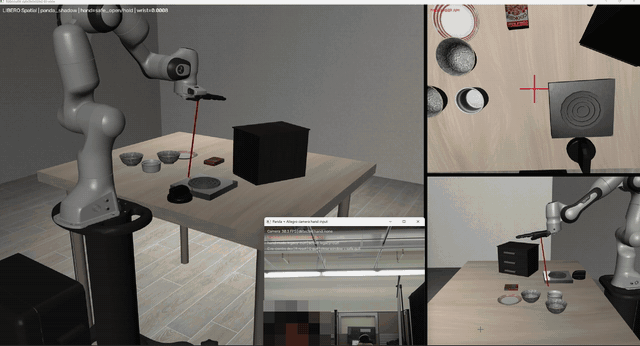
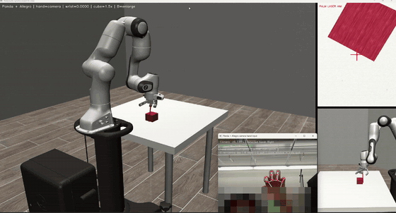
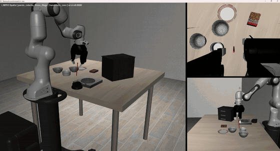
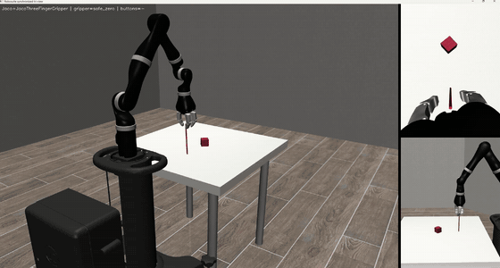
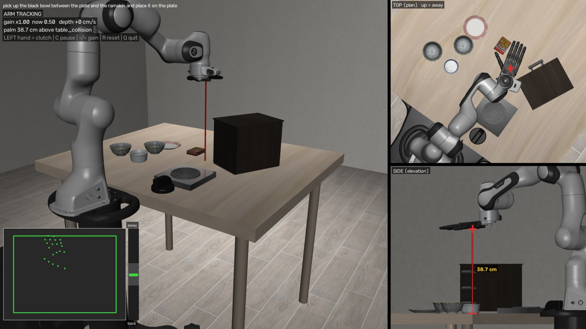

# Vision-Based Hand-Arm Retargeting

**Driving a simulated robot arm and a dexterous robot hand with a SpaceMouse and a laptop webcam.**

  
   
  Panda + Shadow Hand in a LIBERO kitchen scene. The SpaceMouse moves the arm; my right hand in the little webcam window moves the fingers (the pixel blob is my face). 4x speed, click for the 2x MP4.

Hi, I'm Eason, a master's student at UVA, and this is my teleoperation playground in the UVA HRI Lab. The question behind it is pretty simple: how far can you get controlling a robot hand with stuff that's already on your desk? No data glove, no mocap suit, no VR headset. Just a 3Dconnexion SpaceMouse and a webcam.

The setup, in one breath:

- the **SpaceMouse** moves the arm (a Franka Panda, sometimes a Kinova Jaco);
- the **webcam** watches my right hand with MediaPipe, and my finger pose gets copied ("retargeted") onto a robot hand: Allegro (4 fingers), Shadow (5 fingers), or a simpler gripper;
- lately I've been trying to drop the SpaceMouse and do **everything from the webcam**, so where my hand is also moves the arm. That part is still in progress.

It all runs in simulation (robosuite + MuJoCo, plus scenes from the LIBERO benchmark) on a Windows laptop.

### The one rule: no shared control

The robot never helps. No auto-grasp, no snapping to objects, no "smart" correction of my motion: the human's weight is 1. Safety code may slow a command down or refuse it, but it never moves the robot on its own. I even removed two convenience features (a precision mode and a "only rotate around the vertical axis" mode) because they quietly changed how my hand maps onto the robot. If a grasp fails, that's on me and on the interface, and the interface is the thing I actually want to study.

## Demos

Recorded by me on 2026-10-22, trimmed, faces in the webcam window pixelated. GIFs are sped up (4x, Allegro 3x); click one for the MP4 at half that speed.

<table>
  <tr>
    <td width="33%" valign="top">
       
      <b>Panda + Allegro Hand.</b> Grab the cube, lift it. Arm from the SpaceMouse, fingers from the webcam. Getting the thumb to actually pinch took the longest.
    </td>
    <td width="33%" valign="top">
       
      <b>Panda + Robotiq 3-finger gripper</b> in the same LIBERO scene. Hold one SpaceMouse button to close, the other to open.
    </td>
    <td width="33%" valign="top">
       
      <b>Jaco + 3-finger gripper</b> lifting a cube, after I sped up its gripper.
    </td>
  </tr>
</table>

To be upfront: LIBERO has an official success check, and it didn't fire in any of these runs. The task wants the bowl on the plate; in the Shadow clip I put it on the stove. So these clips show that the interface works, they're not benchmark numbers.

## How it works, roughly

### Arm: SpaceMouse

The SpaceMouse gives six numbers per tick: push/pull along three axes and twist around three. I map them relative to the camera you're looking through, so pushing forward always means "into the screen", whatever the robot's base frame thinks. After deadzones and a bit of filtering, each tick becomes a small pose step for robosuite's operational-space controller (`OSC_POSE`). Let go and the target pose freezes, so the arm doesn't keep creeping.

### Fingers: webcam

MediaPipe gives 21 keypoints on my hand every frame. There are two ways to turn those into robot finger angles:

1. **A hand-written mapping (`curl-pinch`).** Measure how bent each of my fingers is, plus how close my thumb tip is to each fingertip, and drive the robot fingers from that. Simple, predictable, and surprisingly good at pinches.
2. **[dex-retargeting](https://github.com/dexsuite/dex-retargeting)** (vector and DexPilot optimizers), which solves for the robot joint angles whose fingertip geometry looks most like mine. It lives in its own Python environment, so the teleop loop talks to it through a side process.

### Webcam-only mode (work in progress)

Here one webcam controls both the arm and the fingers. From a single RGB image the code estimates where my wrist is in 3-D, in meters, using the shape of my palm as a ruler. Then:

- moving my hand left/right/up/down moves the robot like a mouse pointer: slow hand, fine motion; fast hand, bigger jumps;
- depth is the weak axis for one camera, so it works like a joystick instead: hold your hand closer to the camera than where you started and the robot keeps moving away from you, faster the further you push (with a 3 cm deadzone);
- turning my palm turns the robot hand, but only while my hand isn't sliding around, so moving doesn't accidentally twist it;
- showing my left hand is a clutch, like lifting a mouse off the mousepad: the robot holds still while I reset my right hand.

The operator screen for the webcam-only mode: the main view, a top view and a side view (orthographic, so distances don't lie), and the webcam preview with a safe zone and a depth gauge. This shot is from a scripted test hand, not a real run.

## Stuff I learned the hard way

**The drift wasn't the SpaceMouse.** For a while the arm slid around, up to 11 cm, just from me moving the fingers. My first suspect was the SpaceMouse. The real cause: every step the controller re-anchored its goal to wherever the wrist actually was, and the point it tracked wasn't rigid, so small errors kept piling up. Holding a fixed desired pose and moving the control point onto a rigid tool frame took the drift from **109 mm to 0.26 mm**.

**The sim was slow for boring reasons.** The LIBERO loop ran at 8 Hz, which makes teleop feel like steering a boat. The culprits: rendering a camera image nobody used, Python's `sleep` on Windows oversleeping by about 14 ms per call, and resizing a big frame for display. With those fixed it runs at about 21 Hz.

**The Panda's elbow singularity isn't where I thought.** I assumed the arm goes singular when the elbow (joint 4) hits its straight limit at −0.07 rad. Because of small offsets between the Panda's links, it actually loses a direction of motion around **−0.47 rad**. Once the safety margin sat in the right place (keep joint 4 below −0.82 rad, which costs about 1 cm of reach), I could delete my "auto-escape" code. Good riddance: a robot backing itself out of trouble is exactly the kind of help I don't want.

**Thumbs are the hard part.** Four fingers mostly just curl. The thumb has to swing across the palm to meet them. Just bending the Allegro's thumb joints left its tip about 3 cm from the index fingertip in a "pinch". Blending in a proper opposition pose (and later a continuous "how far across the palm is my thumb" value) gets it to about 1.7 cm, basically touching.

## What doesn't work yet

- The SpaceMouse works, but being precise with it still takes practice, especially when you need translation and rotation at the same time.
- The hands are fine at two-finger pinches and simple grasps. More complex finger motions are basically untested, and the thumb logic still needs work.
- Shadow Hand with DexPilot works with synthetic input; I haven't properly tried it with my real hand yet.
- The webcam-only mode has only been tested in closed loop with a scripted fake hand. The numbers look right (fake hand moves 8 cm right, robot moves 10.4 cm; hand stays still, robot drifts 0.0 mm), but a real hand under real lighting is another story.
- No user study. Everything here is "I tried it and it felt OK".

Next up: real-hand runs of the webcam-only mode, finishing the LIBERO task properly (bowl on the *plate*), then a small comparison of the input setups with people who aren't me.

## Running it

Windows only for now. Two virtual environments, because LIBERO wants an older robosuite:

- `.venv-robosuite`: Python 3.10, robosuite 1.5.2, MuJoCo 3.3.7 (`requirements-robosuite-wrist.lock`)
- `.venv-libero`: Python 3.8, robosuite 1.4.0, MuJoCo 3.2.3, plus LIBERO installed from a clone of [LIBERO](https://github.com/Lifelong-Robot-Learning/LIBERO) at commit `8f1084e` in `third_party/LIBERO` (not included in this repo; see `docs/libero_windows.md`)
- dex-retargeting 0.4.6 in its own Conda environment (`third_party/dex_retargeting_0_4_6/PROVENANCE.md`)

The full walkthrough, with diagnostics and smoke tests, is in [`Run Instructions.txt`](Run%20Instructions.txt). The ones I use most:

~~~powershell
# SpaceMouse arm + webcam fingers, Panda + Allegro
& .\.venv-robosuite\Scripts\python.exe .\scripts\run_spacemouse_panda_wrist_teleop.py integrated
# Same idea in a LIBERO scene, Panda + Shadow
& .\.venv-libero\Scripts\python.exe .\scripts\run_libero_spatial_panda_shadow_teleop.py
# Webcam only (C pause, - / = gain, R reset, Q quit)
& .\.venv-libero\Scripts\python.exe .\scripts\run_libero_spatial_panda_shadow_camera_teleop.py
~~~

No SpaceMouse or webcam around? Most scripts take `--headless --headless-smoke` or `--viewer-smoke` and feed in fake input. That's enough to check things start up, not a substitute for a real run.

All entry points

| Script | Environment | Robot | Input |
| --- | --- | --- | --- |
| `scripts/run_spacemouse_panda_wrist_teleop.py integrated` | `.venv-robosuite` | Panda + Allegro, cube | SpaceMouse + webcam (`--hand-control curl-pinch\|dex\|legacy-curl\|off`) |
| `scripts/run_spacemouse_panda_shadow_hand_teleop.py` | `.venv-robosuite` | Panda + Shadow, cube | SpaceMouse + webcam |
| `scripts/run_spacemouse_panda_jaw_gripper_teleop.py` | `.venv-robosuite` | Panda + parallel gripper | SpaceMouse |
| `scripts/run_spacemouse_panda_robotiq85_teleop.py` | `.venv-robosuite` | Panda + Robotiq 85 | SpaceMouse |
| `scripts/run_spacemouse_panda_robotiq_three_finger_teleop.py` | `.venv-robosuite` | Panda + Robotiq 3-finger | SpaceMouse |
| `scripts/run_spacemouse_jaco_three_finger_teleop.py` | `.venv-robosuite` | Jaco + 3-finger gripper | SpaceMouse |
| `scripts/run_libero_spatial_panda_shadow_teleop.py` | `.venv-libero` | LIBERO Spatial, Panda + Shadow | SpaceMouse + webcam (DexPilot by default) |
| `scripts/run_libero_spatial_panda_robotiq_three_finger_teleop.py` | `.venv-libero` | LIBERO Spatial, Panda + Robotiq 3-finger | SpaceMouse |
| `scripts/run_libero_spatial_panda_shadow_camera_teleop.py` | `.venv-libero` | LIBERO Spatial, Panda + Shadow | Webcam only |
| `scripts/calibrate_spacemouse_axes.py` | `.venv-robosuite` | none | Guided SpaceMouse axis calibration |
| `scripts/run_grasp_validation.py --gate 2` | `.venv-robosuite` | Fixed Panda + Allegro | Static-grasp regression check |
| `scripts/run_libero_task_preview.py` | `.venv-libero` | LIBERO scenes | Records a zero-action preview |

## Tests

~~~powershell
& .\.venv-robosuite\Scripts\python.exe -m pytest -q .\tests
& .\.venv-libero\Scripts\python.exe -m pytest -q .\tests\test_libero_spatial_teleop.py .\tests\test_libero_camera_teleop.py .\tests\test_camera_arm_control.py
~~~

Last run (2026-10-23): main suite 200 passed and 9 skipped, plus 1 failure in an old dex-sidecar test written before a default changed (left alone for now); the LIBERO and webcam-only suites 27 passed.

## Where things live

| Path | What's in it |
| --- | --- |
| `src/wrist_teleop/mapper.py`, `device.py`, `axis_calibration.py` | SpaceMouse input, deadzones, axis calibration |
| `src/wrist_teleop/osc.py` | Turning commands into `OSC_POSE` actions, goal freezing |
| `src/wrist_teleop/hand_input.py`, `allegro_hand_input.py`, `shadow_hand_input.py` | Webcam + MediaPipe, hand-written finger mappings |
| `src/wrist_teleop/dex_retargeting.py`, `shadow_dex.py`, `scripts/dex_retargeting_worker.py` | The dex-retargeting side process |
| `src/wrist_teleop/libero_spatial_teleop.py` | LIBERO sessions and the drift fix |
| `src/wrist_teleop/camera_arm_control.py`, `libero_camera_teleop.py`, `operator_views.py` | Webcam-only mode: wrist pose, mapping, safety checks, top/side views |
| `src/wrist_teleop/allegro_model.py`, `shadow_gripper.py`, `visualization.py` | Robot hand models and the three-view display |
| `configs/` | Control, camera and retargeting settings |
| `docs/progress_log_zh.md` | The detailed dev log (in Chinese) |

There's also an older PyBullet / panda-gym version of this project (Panda + Allegro) in `third_party/panda-gym`. I keep it frozen as a reference and hash-check it (`scripts/verify_frozen_baseline_hash.py`) so I don't break it by accident.

## Dev log

- **2026-10-23** Webcam-only mode v2: pointer-style mapping, joystick-style depth, left-hand clutch, top/side views. Removed every bit of robot-moves-on-its-own recovery, plus the precision and rotation modes.
- **2026-10-22** LIBERO with Shadow and Robotiq 3-finger; the drift fix (109 mm to 0.26 mm); 8 Hz to 21 Hz; DexPilot for Shadow; camera-relative SpaceMouse mapping and axis calibration; thumb opposition for Allegro.
- **2026-10-20** First real-hand session driving all 16 Allegro joints through dex-retargeting.
- **2026-10-15 to 10-19** Shadow Hand, 3-finger grippers, video recording, LIBERO scene previews, a "palm laser" that shows where the palm is pointing.
- **2026-09-22** robosuite version up and running: Panda + Allegro with dex-retargeting, Panda / Jaco grippers, three-view display.

The long version is in [`docs/progress_log_zh.md`](docs/progress_log_zh.md) (Chinese).

## Credits

Built on robosuite, MuJoCo, LIBERO, MediaPipe and dex-retargeting. panda-gym (MIT), dex-retargeting 0.4.6 (MIT), the dex-urdf Shadow Hand (Apache-2.0) and the MuJoCo Menagerie Shadow Hand assets keep their own licenses; see `THIRD_PARTY_NOTICES.md`. LIBERO (MIT) is used from an outside clone and isn't redistributed here.
