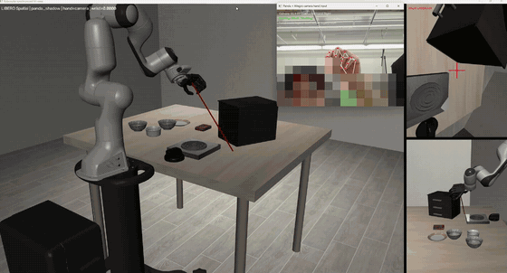

# Vision-Based Hand-Arm Retargeting

A Windows research platform for teleoperating robot arms with dexterous hands in simulation. A human operator drives a Franka Panda (or Kinova Jaco) arm with a 3Dconnexion SpaceMouse, or with a single webcam only, while the operator's hand, tracked by MediaPipe, is retargeted to an Allegro Hand, a Shadow Hand or a multi-finger gripper. The mainline is **robosuite 1.5.2 + MuJoCo 3.3.7 + Panda + OSC_POSE**; official **LIBERO** scenes run in an isolated robosuite 1.4 environment.

> **Project affiliation:** developed within the University of Virginia Human-Robot Interaction Laboratory (UVA HRI Lab).

**Design principle — no shared control.** The teleoperation system contains no automatic or "smart" grasp assistance: every motion comes from the operator (the human's weight in shared control is 1). Safety layers may only slow down or stop a command; they never move the robot on their own.

## Demos

Recorded on 2026-10-22 by a human operator in simulation (SpaceMouse for the arm, webcam for the fingers). Clips are trimmed and sped up; the operator's face and bystanders in the webcam window are pixelated. Click a preview for the MP4.

| | |
| --- | --- |
|  |  |
| **LIBERO Spatial, Panda + Shadow Hand** — picking up and placing a bowl in an official scene. Arm: SpaceMouse; fingers: webcam, rule-based curl mapping (`legacy-curl`). 2x speed. | **LIBERO Spatial, Panda + Robotiq three-finger gripper** — picking up and placing the bowl. Arm and gripper: SpaceMouse (hold-to-close / hold-to-open). 2x speed. |
|  |  |
| **Panda + Allegro Hand (palm-down)** — grasping and lifting the cube. Arm: SpaceMouse; fingers: webcam, `curl-pinch` mapping with thumb opposition. 1.5x speed. | **Jaco + JacoThreeFingerGripper** — grasping and lifting the cube with the faster continuous gripper control. 2x speed. |
|  |  |
| **Webcam to Shadow Hand fingers** — thumb–finger pinches mapped onto the Shadow Hand (`legacy-curl`). 1x speed. | **Camera-only teleoperation UI (2026-10-23)** — main view, orthographic top and side views with palm height, embedded webcam preview with safe zone and depth gauge. Synthetic-hand smoke run; real-hand recording pending. |

These are teleoperation demonstrations, not benchmark results: LIBERO's official task-success predicate was not triggered in these runs and is not claimed.

## What the platform provides

- **Arm teleoperation (SpaceMouse).** Camera-relative 6-DoF increments (push forward = into the screen) through robosuite OSC_POSE, with neutral-offset estimation, hysteretic deadzones, dominant translation/rotation decoupling, guided axis calibration and a desired-goal guard that latches the goal when the device is released, so the arm neither drifts nor keeps moving.
- **End effectors.** Allegro Hand (16 joints, 2/3 scale, palm-down teleoperation variant), Shadow Hand (20 actuators, rigid OSC TCP), Robotiq 85, Robotiq three-finger, Jaco three-finger and the Panda parallel gripper. The camera only writes the hand slice of the action; the SpaceMouse only writes the arm slice.
- **Hand retargeting.** Official dex-retargeting 0.4.6 runs in an isolated sidecar process (Allegro vector optimizer; Shadow DexPilot with a dex-urdf model whose fingertips match the MuJoCo Shadow to 0.1 mm), plus a rule-based `curl-pinch` mapping with continuous thumb opposition.
- **LIBERO Spatial.** Official scenes and initial states with Panda + Shadow and Panda + Robotiq three-finger. A desired-pose adapter and a rigid TCP reduced end-effector drift during finger motion from 109 mm to 0.26 mm; the loop runs at about 21 Hz with a native 1920x1080 three-view display.
- **Camera-only teleoperation (no SpaceMouse).** One webcam drives both the arm and the Shadow fingers; see below.

## Camera-only teleoperation (LIBERO, Panda + Shadow)

`scripts/run_libero_spatial_panda_shadow_camera_teleop.py` (use `.venv-libero`). The operator's right hand moves the end effector; the same detection retargets the fingers.

| Operator | Robot |
| --- | --- |
| Move the right hand left/right, up/down | End effector follows incrementally, like a mouse pointer: about 0.5x hand travel when slow, up to about 1.8x when fast (pointer acceleration) |
| Hold the hand nearer / farther than its starting depth | End effector moves away / back at a speed proportional to the offset (rate control, 3 cm deadzone, max 0.12 m/s) |
| Turn or tilt the hand | End effector follows the whole palm rotation, applied only while the hand is not translating |
| Show the left hand next to the right one | Clutch: the arm holds while the right hand is repositioned, then continues from where it is |
| Keys | `C` pause/resume, `-` / `=` gain, `R` reset, `Q` quit |

Key components (`src/wrist_teleop/camera_arm_control.py`, all constants in `CameraArmSettings`):

- **Monocular metric wrist pose.** A time-averaged 3-D palm template (MediaPipe world landmarks) is placed so that each palm point lies on its pixel's viewing ray, a small linear least-squares problem that is exact off-centre and under rotation, and independent of finger closure.
- **Filtering.** One Euro filters, per-axis deadbands with fine-follow hysteresis, outlier rejection and re-acquisition without jumps; a still hand gives exactly zero target motion in tests with 1–2 px detection noise.
- **Safety without autonomy.** Workspace box around the task objects, reach and base-axis limits, orientation limits, a follow leash (the target never leads the commanded goal by more than 0.25 s of travel), and a Jacobian-based guard with three-step look-ahead against joint limits and low manipulability. The Panda's stretched-elbow singularity lies at joint 4 ≈ −0.47 rad because of the 0.0825 m link offsets, not at the −0.07 rad joint limit; keeping the elbow at ≤ −0.82 rad (about 1 cm less reach) removed the need for any autonomous escape motion. Refused commands are dropped rather than accumulated, and a virtual wall lifts as soon as the operator moves away or a re-check finds the motion safe.
- **Operator views.** Orthographic plan and elevation cameras aligned with the operator's axes, a vertical palm laser with clearance, and the embedded webcam preview.

Verified in the LIBERO scene with a synthetic hand (simulated time): hand right 8 cm → end effector 104 mm; hand held 7 cm nearer the camera → 98 mm away, and 0.0 mm drift after returning to neutral; up 6 cm → 59 mm; knob turn 30° → 29.5° yaw; still hand → 0.0 mm. Real-hand evaluation of the new mapping is pending.

## Status

| Area | Status |
| --- | --- |
| SpaceMouse arm control, all entry points | Verified in simulation and in human-operated sessions |
| Panda + Allegro with webcam fingers (curl-pinch; dex optional) | Human-operated cube grasp recorded |
| LIBERO Spatial Panda + Shadow / Robotiq three-finger | Human-operated bowl pick-and-place recorded |
| Shadow DexPilot (dex-retargeting) finger mapping | Implemented and verified with synthetic input; human evaluation pending |
| Camera-only arm teleoperation (2026-10-23 mapping) | Verified in closed-loop simulation with a synthetic hand; human evaluation pending |
| Gate 2 fixed-Panda static grasp (2/3-scale Allegro) | Passes 1/1, 3/3 and 10/10 |
| Frozen PyBullet / panda-gym reference | 172/173 hashes match; the one pre-existing mismatch is `src/teleop/teleop_factory.py` |

## Entry points

| Script | Environment | Robot and end effector | Inputs |
| --- | --- | --- | --- |
| `scripts/run_spacemouse_panda_wrist_teleop.py integrated` | `.venv-robosuite` | Panda + Allegro, Lift cube | SpaceMouse + webcam (`--hand-control curl-pinch\|dex\|legacy-curl\|off`) |
| `scripts/run_spacemouse_panda_shadow_hand_teleop.py` | `.venv-robosuite` | Panda + Shadow Hand, Lift cube | SpaceMouse + webcam (rule-based curl) |
| `scripts/run_spacemouse_panda_jaw_gripper_teleop.py` | `.venv-robosuite` | Panda + parallel gripper | SpaceMouse |
| `scripts/run_spacemouse_panda_robotiq85_teleop.py` | `.venv-robosuite` | Panda + Robotiq 85 | SpaceMouse |
| `scripts/run_spacemouse_panda_robotiq_three_finger_teleop.py` | `.venv-robosuite` | Panda + Robotiq three-finger | SpaceMouse |
| `scripts/run_spacemouse_jaco_three_finger_teleop.py` | `.venv-robosuite` | Jaco + three-finger gripper | SpaceMouse |
| `scripts/run_libero_spatial_panda_shadow_teleop.py` | `.venv-libero` | LIBERO Spatial, Panda + Shadow | SpaceMouse + webcam (`--hand-control dex` default) |
| `scripts/run_libero_spatial_panda_robotiq_three_finger_teleop.py` | `.venv-libero` | LIBERO Spatial, Panda + Robotiq three-finger | SpaceMouse |
| `scripts/run_libero_spatial_panda_shadow_camera_teleop.py` | `.venv-libero` | LIBERO Spatial, Panda + Shadow | Webcam only |
| `scripts/calibrate_spacemouse_axes.py` | `.venv-robosuite` | — | Guided SpaceMouse axis calibration |
| `scripts/run_grasp_validation.py --gate 2` | `.venv-robosuite` | Fixed Panda + Allegro | Locked static-grasp regression |
| `scripts/run_libero_task_preview.py` | `.venv-libero` | Official LIBERO scenes | Zero-action preview recording |

Most interactive scripts accept `--headless --headless-smoke` or `--viewer-smoke` for hardware-free checks with synthetic input; these do not replace human testing.

## Setup

See `Run Instructions.txt` for the full Windows setup, diagnostics and smoke tests. In short:

- `.venv-robosuite`: Python 3.10, robosuite 1.5.2, MuJoCo 3.3.7 (`requirements-robosuite-wrist.lock`).
- `.venv-libero`: Python 3.8, robosuite 1.4.0, MuJoCo 3.2.3 and LIBERO 0.1.0 installed from a clone of <https://github.com/Lifelong-Robot-Learning/LIBERO> at commit `8f1084e` in `third_party/LIBERO` (not vendored; `requirements-libero-teleop.lock`, `docs/libero_windows.md`).
- dex-retargeting sidecar: a separate Conda interpreter with the verified dex-retargeting 0.4.6 wheel (`third_party/dex_retargeting_0_4_6/PROVENANCE.md`).

~~~powershell
Set-Location "E:\hand_arm_retargeting"
& .\.venv-robosuite\Scripts\python.exe .\scripts\run_spacemouse_panda_wrist_teleop.py integrated
& .\.venv-libero\Scripts\python.exe .\scripts\run_libero_spatial_panda_shadow_teleop.py
& .\.venv-libero\Scripts\python.exe .\scripts\run_libero_spatial_panda_shadow_camera_teleop.py
& .\.venv-libero\Scripts\python.exe .\scripts\run_libero_spatial_panda_shadow_camera_teleop.py --viewer-smoke
~~~

## Tests

~~~powershell
& .\.venv-robosuite\Scripts\python.exe -m pytest -q .\tests
& .\.venv-libero\Scripts\python.exe -m pytest -q .\tests\test_libero_spatial_teleop.py .\tests\test_libero_camera_teleop.py .\tests\test_camera_arm_control.py
& .\.venv-robosuite\Scripts\python.exe .\scripts\verify_frozen_baseline_hash.py
~~~

Latest results (2026-10-23): mainline suite 200 passed and 9 skipped, with one known failure (`test_dex_sidecar_runtime.py::...open_and_closed_hand`, outdated by the relative-neutral dex default and intentionally left unchanged); LIBERO and camera-only suites 27 passed; frozen-baseline check 172/173.

## Project map

| Path | Purpose |
| --- | --- |
| `src/wrist_teleop/camera_arm_control.py` | Monocular wrist pose, camera-to-arm mapping, workspace limits and safety guard |
| `src/wrist_teleop/libero_camera_teleop.py`, `operator_views.py` | Camera-only LIBERO loop and orthographic operator views |
| `src/wrist_teleop/libero_spatial_teleop.py` | LIBERO session, desired-pose OSC adapter, Shadow / Robotiq specs |
| `src/wrist_teleop/mapper.py`, `device.py`, `axis_calibration.py` | SpaceMouse input, decoupling and calibration |
| `src/wrist_teleop/osc.py` | OSC_POSE action composition and desired-goal guard |
| `src/wrist_teleop/hand_input.py`, `allegro_hand_input.py`, `shadow_hand_input.py` | Webcam capture, MediaPipe, rule-based finger mappings |
| `src/wrist_teleop/dex_retargeting.py`, `shadow_dex.py`, `scripts/dex_retargeting_worker.py` | dex-retargeting sidecar (Allegro, Shadow DexPilot) |
| `src/wrist_teleop/allegro_model.py`, `shadow_gripper.py` | Allegro and Shadow robosuite models |
| `src/wrist_teleop/visualization.py` | Synchronized three-view rendering and the non-physical palm laser |
| `configs/` | Control, camera, laser and dex-retargeting configuration |
| `third_party/panda-gym` | Frozen legacy PyBullet reference baseline (hash-audited, not modified) |
| `docs/progress_log_zh.md` | Detailed development log (Chinese) |

## Progress log

- **2026-10-23** — Camera-only teleoperation v2: incremental mapping with pointer acceleration, depth rate control, whole-palm rotation held during translation, left-hand clutch, orthographic top/side views with an embedded webcam preview, auto-releasing virtual walls, and removal of all autonomous recovery motion (elbow-singularity margin corrected). Mode switches that change the operator-to-robot mapping (precision mode, rotation modes) were removed.
- **2026-10-22** — LIBERO Spatial Panda + Shadow / Robotiq three-finger teleoperation; drift fix (desired-pose OSC adapter and rigid TCP, 109 mm → 0.26 mm); 2.5x arm speed and 21 Hz display; Shadow DexPilot via dex-retargeting; SpaceMouse translation/rotation decoupling and guided axis calibration; palm-down Allegro with curl-pinch thumb opposition; Gate 2 re-qualified for the 2/3-scale Allegro; first camera-only teleoperation entry.
- **2026-10-20** — Relative-neutral Allegro dex mapping; a real-hand session moved all 16 Allegro joints through the dex sidecar.
- **2026-10-15 / 10-19** — Shadow Hand runtime, three-finger grippers with continuous control, MP4 recording, LIBERO scene previews for five suites, palm laser and palm-view camera.
- **2026-09-22** — robosuite mainline baseline: Panda + Allegro with official dex-retargeting sidecar, Panda / Jaco grippers, three-view visualization.

## Third-party components

See `THIRD_PARTY_NOTICES.md`. panda-gym (MIT), dex-retargeting 0.4.6 (MIT), dex-urdf Shadow Hand (Apache-2.0) and MuJoCo Menagerie Shadow Hand assets keep their own licenses. LIBERO (MIT) is used from an external clone and is not redistributed here.
